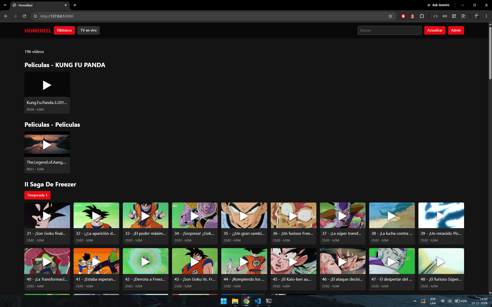
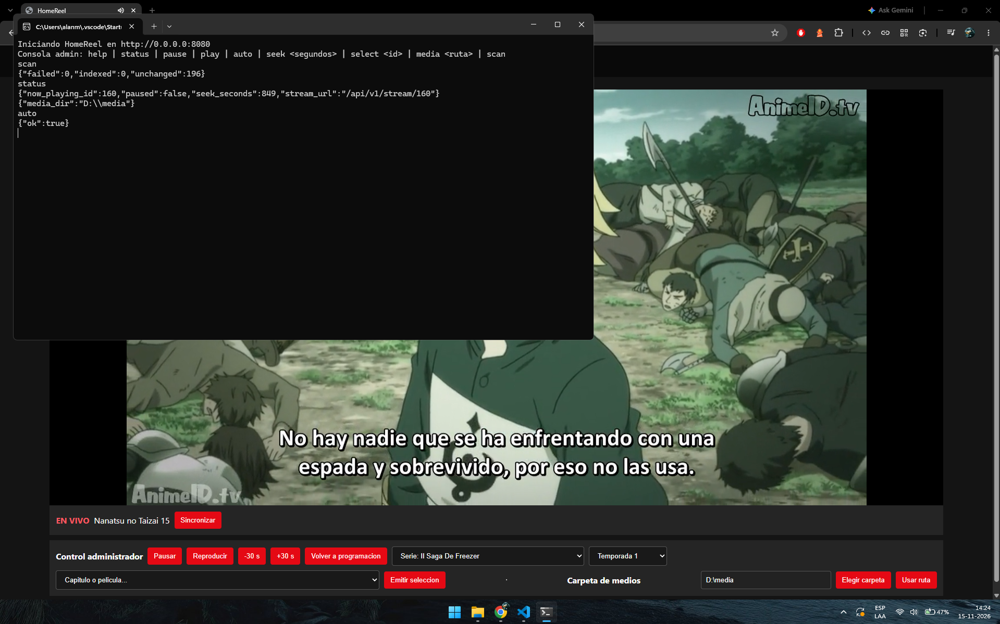
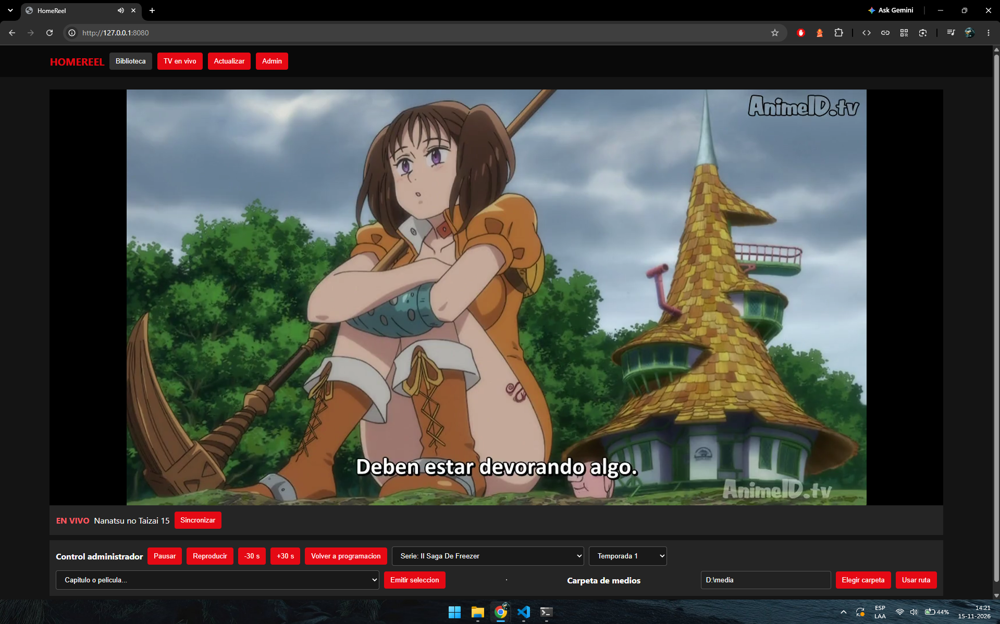

# HomeReel

**HomeReel es un servidor multimedia personal para reproducir una biblioteca de vídeos en una red local, pensado para hogares que quieren acceder a sus películas y series desde el navegador, una Smart TV o una Raspberry Pi.**

## Tabla de contenidos

- [Demo local y en LAN](#demo-local-y-en-lan)
- [Problema que resuelve](#problema-que-resuelve)
- [Características](#características)
- [Stack tecnológico](#stack-tecnológico)
- [Inicio rápido](#inicio-rápido)
- [Configuración](#configuración)
- [Uso](#uso)
- [Decisiones técnicas](#decisiones-técnicas)
- [Organización de la biblioteca](#organización-de-la-biblioteca)
- [Administración y arranque automático](#administración-y-arranque-automático)
- [Roadmap y limitaciones](#roadmap-y-limitaciones)
- [Licencia](#licencia)
- [Contacto](#contacto)

## Demo local y en LAN

HomeReel se ejecuta en el puerto `8080` y escucha en todas las interfaces de red (`0.0.0.0`).

- En el equipo que ejecuta el servidor: [http://localhost:8080](http://localhost:8080).
- Desde otro dispositivo de la misma red: `http://IP_DEL_HOST:8080` (por ejemplo, `http://192.168.1.20:8080`).

> La aplicación está diseñada para redes locales de confianza; no debe exponerse directamente a Internet.

| Biblioteca multimedia | Consola de administración |
| --- | --- |
|  |  |
| Reproducción de película | Vista de administrador del canal en vivo |
|  |  |

## Problema que resuelve

Organizar y reproducir una colección personal de vídeos suele requerir configurar varios servicios o depender de plataformas externas. HomeReel escanea una carpeta de medios, crea un catálogo navegable y sirve los archivos directamente a cualquier navegador de la LAN.

Está orientado a hogares, especialmente a instalaciones ligeras como una Raspberry Pi 3, que buscan una alternativa sencilla para vídeo bajo demanda y un canal compartido en vivo sin transcodificación.

## Características

- Catálogo de películas, series, temporadas y episodios a partir de la estructura de carpetas.
- Reproducción bajo demanda con soporte HTTP Range para avanzar y retroceder.
- Canal de TV en vivo sincronizado: todos los clientes ven el mismo punto del ciclo de reproducción.
- Escaneo incremental: solo procesa con `ffprobe` los archivos nuevos o modificados.
- Persistencia con SQLite y estado de vídeos desconectados, útil para discos extraíbles.
- Panel web para actualizar la biblioteca y controlar el canal compartido.
- Consola local para administrar la reproducción desde el terminal.

## Stack tecnológico

| Tecnología | Uso |
| --- | --- |
| [Go](https://go.dev/) 1.26+ | Backend, API HTTP, escáner y servidor de archivos. |
| SQLite con [`modernc.org/sqlite`](https://pkg.go.dev/modernc.org/sqlite) | Catálogo y estado persistente; funciona sin CGO. |
| FFmpeg (`ffprobe`) | Lectura de duración y códec de los vídeos. |
| HTML, CSS y JavaScript | Interfaz web y reproductor del cliente. |
| HTTP Range | Streaming directo de vídeo y función de búsqueda temporal. |

## Inicio rápido

### Requisitos previos

- [Go](https://go.dev/dl/) 1.26 o posterior, para compilar desde el código fuente.
- [FFmpeg](https://ffmpeg.org/) disponible en el `PATH` (incluye `ffprobe`).
- Una biblioteca de archivos `.mp4` o `.mkv`. Para mayor compatibilidad en navegadores y Smart TV, se recomienda MP4 con vídeo H.264 y audio AAC.

### Windows

1. Clona el repositorio:

   ```powershell
   git clone https://github.com/alanmunozcabello/HomeReel.git
   cd HomeReel
   ```

2. Ejecuta `Installer.cmd` con doble clic. El instalador verifica o instala Go y FFmpeg mediante `winget`, compila `HomeReel.exe` y crea una regla de firewall para el puerto 8080.
3. Inicia `HomeReel.exe`.
4. Abre [http://localhost:8080](http://localhost:8080) o usa la IP del equipo desde otro dispositivo de la LAN.

### Linux y Raspberry Pi

1. Clona el repositorio:

   ```bash
   git clone https://github.com/alanmunozcabello/HomeReel.git
   cd HomeReel
   ```

2. Instala dependencias y compila:

   ```bash
   bash scripts/install-linux.sh
   ```

   El script usa `apt` para instalar Go y FFmpeg.

3. Inicia el servidor:

   ```bash
   ./homereel
   ```

4. Abre [http://localhost:8080](http://localhost:8080) o `http://IP_DEL_HOST:8080` desde la misma red local.

### macOS

1. Descarga el paquete correspondiente desde los archivos adjuntos del release: `HomeReel-macos-arm64.pkg` para Apple Silicon o `HomeReel-macos-amd64.pkg` para Intel.
2. Abre el paquete y sigue el instalador.
3. Instala FFmpeg si es necesario:

   ```bash
   brew install ffmpeg
   ```

4. Inicia el servidor:

   ```bash
   homereel
   ```

Por defecto, macOS utiliza `~/HomeReel/media` como biblioteca. Los paquetes se generan con el flujo de GitHub Actions **macOS package**. Para evitar avisos de Gatekeeper al distribuirlos, es necesario firmarlos y notarizarlos con una cuenta de Apple Developer.

### Compilación manual

Si ya tienes Go y FFmpeg instalados, el flujo mínimo es:

```bash
git clone https://github.com/alanmunozcabello/HomeReel.git
cd HomeReel
go build -o homereel ./cmd/server
./homereel
```

En Windows, el ejecutable puede llamarse `HomeReel.exe`:

```powershell
go build -o HomeReel.exe .\cmd\server
.\HomeReel.exe
```

## Configuración

No se requiere archivo `.env`. Estas variables de entorno son opcionales:

| Variable | Predeterminado | Descripción |
| --- | --- | --- |
| `MEDIA_DIR` | `./media` | Ruta absoluta o relativa de la biblioteca de vídeos. |
| `DB_PATH` | `./data/streamer.db` | Ubicación del archivo SQLite. |
| `PORT` | `8080` | Puerto HTTP del servidor. |

Ejemplo en Linux:

```bash
MEDIA_DIR=/mnt/media PORT=8080 ./homereel
```

## Uso

La primera carga realiza un escaneo automático. Usa **Actualizar** para indexar los cambios; también puedes iniciar un escaneo con `POST /api/v1/library/scan`.

- **Biblioteca:** reproduce vídeos bajo demanda. `GET /api/v1/library` expone el catálogo y `GET /api/v1/stream/{id}` sirve el archivo con soporte Range.
- **TV en vivo:** `GET /api/v1/tv/live` calcula el vídeo y segundo actual del ciclo. Los clientes se sincronizan al entrar, al terminar un vídeo y cada 30 segundos.
- **Admin:** permite seleccionar un vídeo, pausar, reproducir, avanzar 30 segundos o volver a la programación automática. No hay autenticación ni sesiones: las acciones afectan a todos los clientes conectados.

## Decisiones técnicas

- **Sin transcodificación:** HomeReel sirve el archivo original para mantener bajo el uso de CPU y memoria; es una decisión especialmente importante en Raspberry Pi 3. Por ello, la compatibilidad de reproducción depende del códec que soporte el dispositivo cliente.
- **SQLite en modo WAL:** permite que el escaneo escriba en el catálogo mientras las solicitudes de streaming lo consultan, reduciendo conflictos de bloqueo.
- **Go sin CGO:** `modernc.org/sqlite` permite compilar para ARM sin requerir bibliotecas C en el entorno de destino.
- **Escaneo diferencial y pool limitado:** los archivos sin cambios no se vuelven a analizar, y `ffprobe` se limita a dos procesos concurrentes para no saturar equipos modestos.

## Organización de la biblioteca

HomeReel infiere el tipo de contenido según la ruta bajo `MEDIA_DIR`:

```text
media/
├── series/<serie>/<temporada>/<capitulo>.mp4
├── series/<serie>/<capitulo>.mp4
├── peliculas/<pelicula>/<archivo>.mp4
└── peliculas/<archivo>.mp4
```

Una serie sin carpeta de temporada se muestra como **Temporada 1**. Los vídeos que dejan de estar disponibles —por ejemplo, al desconectar un disco— se conservan en el catálogo como no disponibles en lugar de eliminarse.

## Administración y arranque automático

Desde la consola donde se ejecuta el servidor puedes usar:

```text
help
status
pause
play
seek 120
select 42
auto
media /mnt/media
scan
```

`media <ruta>` guarda la carpeta raíz en `data/settings.json` e inicia un escaneo. En Windows, el panel **Admin** incluye un selector nativo de carpetas; en Linux/Raspberry Pi se puede escribir la ruta montada, como `/mnt/media`.

Para iniciar automáticamente HomeReel en Linux/Raspberry Pi, crea `/etc/systemd/system/homereel.service` y ajusta las rutas a tu instalación:

```ini
[Unit]
Description=HomeReel
After=network.target

[Service]
Type=simple
User=pi
WorkingDirectory=/opt/homereel
Environment=MEDIA_DIR=/mnt/media
Environment=PORT=8080
ExecStart=/opt/homereel/homereel
Restart=on-failure
RestartSec=5

[Install]
WantedBy=multi-user.target
```

Después, habilítalo con:

```bash
sudo systemctl daemon-reload
sudo systemctl enable --now homereel
sudo systemctl status homereel
```

Un servicio de `systemd` no tiene consola interactiva; usa la interfaz web o los endpoints de administración desde SSH.

## Roadmap y limitaciones

- [ ] Añadir autenticación y control de acceso antes de considerar un uso fuera de una LAN de confianza.
- [ ] Firmar y notarizar los paquetes de macOS para una instalación sin advertencias de Gatekeeper.
- [ ] Ampliar la compatibilidad de formatos manteniendo el objetivo de no transcodificar.

## Licencia

Este proyecto se distribuye bajo la [licencia MIT](LICENSE).

## Contacto

- GitHub: [@alanmunozcabello](https://github.com/alanmunozcabello)
- Portafolio: [alanmunozcabello.github.io/Portfolio](https://alanmunozcabello.github.io/Portfolio/)
